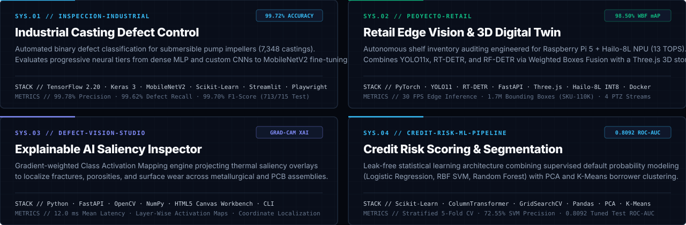
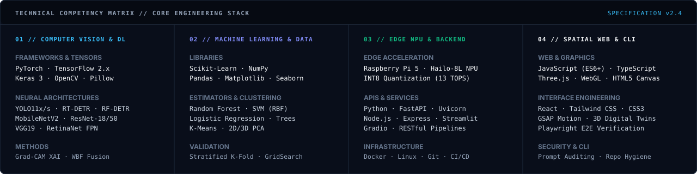

<p align="center">
  
</p>

<p align="center">
  <a href="https://linkedin.com/in/alfredo-ramos-olivan-07751a3a5">
    
  </a>
  <a href="mailto:alfredooliva765498@gmail.com">
    
  </a>
  <a href="https://github.com/Alfredo-ctrl?tab=repositories">
    
  </a>
  
</p>

---

## I. Executive Profile

Artificial Intelligence and Computer Vision Engineer focused on designing, training, and deploying production-grade visual perception systems, statistical machine learning pipelines, and interactive spatial interfaces.

My engineering work spans the complete lifecycle of intelligent systems: from dataset curation, leak-free preprocessing, and multi-stage convolutional fine-tuning (**PyTorch**, **TensorFlow / Keras 3**, **Scikit-Learn**) to low-latency edge quantization (**Raspberry Pi 5 + Hailo-8L 13 TOPS NPU**), asynchronous inference APIs (**FastAPI**), and 3D digital twin visualization (**Three.js / WebGL**).

```text
NAME          Alfredo Ramos
DISCIPLINE    Artificial Intelligence, Computer Vision & Systems Engineering
PRIMARY STACK Python, PyTorch, TensorFlow, Keras 3, Scikit-Learn, OpenCV, FastAPI, Three.js, TypeScript
EDGE TARGETS  Raspberry Pi 5, Hailo-8L NPU (13 TOPS INT8), Apple Silicon MPS, Docker Containers
METHODOLOGY   Reproducible pipelines, cost-sensitive recall calibration, explainable AI (Grad-CAM)
```

---

## II. Flagship Engineering Systems

<p align="center">
  
</p>

| System | Domain | Core Architecture & Stack | Empirical Benchmarks & Capabilities |
| :--- | :--- | :--- | :--- |
| **[inspeccion-industrial](https://github.com/Alfredo-ctrl/inspeccion-industrial)** | Deep Learning & Quality Control | `TensorFlow 2.20` `Keras 3` `MobileNetV2` `Streamlit` `Playwright` | Automated binary defect detection across `7,348` submersible pump impeller castings. Evaluates 5 progressive architectures from dense MLP to MobileNetV2 fine-tuning, achieving **`99.72%` test accuracy** and **`99.62%` defect recall** (`713/715` test castings). |
| **[peoyecto-retail](https://github.com/Alfredo-ctrl/peoyecto-retail)** | Edge Computer Vision & 3D Twin | `PyTorch` `YOLO11x` `RT-DETR` `RF-DETR` `Hailo-8L` `FastAPI` `Three.js` | Autonomous retail shelf inventory system trained on SKU-110K (`1.7M` bounding boxes). Combines multi-detector Weighted Boxes Fusion (**`98.5%` mAP**) with `30 FPS` INT8 edge execution on Raspberry Pi 5 and a standalone Three.js 3D store simulator. |
| **[defect-vision-studio](https://github.com/Alfredo-ctrl/defect-vision-studio)** | Explainable AI (XAI) | `Python` `Grad-CAM` `FastAPI` `OpenCV` `HTML5 Canvas` | Spatial interpretability engine implementing Gradient-weighted Class Activation Mapping ($L_{\text{Grad-CAM}}^c = \text{ReLU}(\sum_k \alpha_k^c A^k)$) for real-time defect hotspot localization (`12.0 ms` mean latency) across REST, CLI, and web interfaces. |
| **[credit-risk-ml-pipeline](https://github.com/Alfredo-ctrl/credit-risk-ml-pipeline)** | Statistical Machine Learning | `Scikit-Learn` `ColumnTransformer` `GridSearchCV` `PCA` `K-Means` | Leak-free credit default probability pipeline on the German Credit dataset (`N = 1,000`). Compares Logistic Regression, RBF SVM, Random Forest, and Decision Trees via 5-fold Stratified CV (**`0.8092` test ROC-AUC**), paired with 2D PCA and K-Means segmentation. |
| **[neural-style-transfer-api](https://github.com/Alfredo-ctrl/neural-style-transfer-api)** | Deep Learning Synthesis | `PyTorch` `VGG19` `FastAPI` `JavaScript` | Production neural style transfer service leveraging intermediate VGG19 perceptual feature representations and Gram matrix optimization, exposed via an asynchronous FastAPI server and interactive web workbench. |
| **[conaempleo-showcase](https://github.com/Alfredo-ctrl/conaempleo-showcase)** | Platform Architecture | `JavaScript` `CSS3` `System Design` `Security` | Sanitized public reference architecture of the CONAEMPLEO institutional employability platform, demonstrating multi-role workflows, bilingual interface systems, and strict data-isolation boundaries. |

---

## III. Technical Competency & Stack Matrix

<p align="center">
  
</p>

| Layer | Technologies & Methodologies |
| :--- | :--- |
| **Deep Learning & Computer Vision** | `PyTorch` · `TensorFlow 2.20` · `Keras 3` · `OpenCV` · `YOLO11` · `RT-DETR` · `RF-DETR` · `MobileNetV2` · `ResNet-18/50` · `VGG19` · `RetinaNet FPN` · `Weighted Boxes Fusion (WBF)` · `Grad-CAM Saliency` · `Perspective Homography` |
| **Machine Learning & Data Science** | `Scikit-Learn` · `NumPy` · `Pandas` · `Matplotlib` · `Seaborn` · `Logistic Regression` · `Support Vector Machines (RBF)` · `Random Forest` · `K-Means Clustering` · `Principal Component Analysis (PCA)` · `Stratified K-Fold CV` · `GridSearchCV` |
| **Edge AI, Backend & Infrastructure** | `Raspberry Pi 5` · `Hailo-8L NPU (13 TOPS)` · `INT8 Post-Training Quantization` · `FastAPI` · `Uvicorn` · `Node.js` · `Streamlit` · `Gradio` · `Docker` · `Docker Compose` · `Linux / Bash` · `Git` |
| **Spatial Web, Frontend & Tooling** | `JavaScript (ES2024)` · `TypeScript` · `Three.js` · `WebGL` · `HTML5 Canvas` · `React` · `Tailwind CSS` · `CSS3 Architecture` · `GSAP` · `Playwright Automated Testing` · `CLI Systems` |

---

## IV. Complete Repository Index

### 01 // Computer Vision, Deep Learning & Machine Learning
- **[inspeccion-industrial](https://github.com/Alfredo-ctrl/inspeccion-industrial)** — Automated industrial casting defect inspection via MobileNetV2 fine-tuning (`99.72%` accuracy, `99.62%` recall).
- **[peoyecto-retail](https://github.com/Alfredo-ctrl/peoyecto-retail)** — Edge-accelerated retail inventory computer vision system (`YOLO11` + `RT-DETR` + `Hailo-8L NPU`) and Three.js 3D store twin.
- **[defect-vision-studio](https://github.com/Alfredo-ctrl/defect-vision-studio)** — Explainable AI (`Grad-CAM`) defect saliency engine with FastAPI backend, CLI utility, and interactive inspection workbench.
- **[credit-risk-ml-pipeline](https://github.com/Alfredo-ctrl/credit-risk-ml-pipeline)** — End-to-end credit risk scoring and borrower segmentation pipeline using Scikit-Learn, Stratified `GridSearchCV`, `PCA`, and `K-Means`.
- **[neural-style-transfer-api](https://github.com/Alfredo-ctrl/neural-style-transfer-api)** — Deep convolutional style transfer engine powered by `PyTorch`, `VGG19`, and `FastAPI`.
- **[vision-document-scanner](https://github.com/Alfredo-ctrl/vision-document-scanner)** — Document contour detection, Canny edge extraction, and 4-point perspective homography pipeline.
- **[signalforge-ai](https://github.com/Alfredo-ctrl/signalforge-ai)** — Time-series telemetry anomaly detection and incident diagnostics laboratory.
- **[clusternebula](https://github.com/Alfredo-ctrl/clusternebula)** — Interactive 3D data science laboratory visualizing `K-Means` clustering trajectories in `Three.js` / `WebGL`.

### 02 // Developer CLI, AI Safety & Workflow Engineering
- **[ia-oculta](https://github.com/Alfredo-ctrl/ia-oculta)** — Security command-line scanner detecting hidden prompt injections, zero-width Unicode steganography, and adversarial LLM payloads.
- **[repodoctor](https://github.com/Alfredo-ctrl/repodoctor)** — Automated repository auditing CLI verifying documentation completeness, structural hygiene, and secret exposure risks.
- **[promptframe](https://github.com/Alfredo-ctrl/promptframe)** — Deterministic prompt engineering workbench for structuring system instructions, constraints, and evaluation rubrics.
- **[flowfixer](https://github.com/Alfredo-ctrl/flowfixer)** — Structured debugging diagnostic engine mapping runtime exceptions to deterministic resolution workflows.
- **[briefsmith](https://github.com/Alfredo-ctrl/briefsmith)** — Technical specification generator transforming product requirements into scoped architecture roadmaps.
- **[lifepilot](https://github.com/Alfredo-ctrl/lifepilot)** — Dual-surface (Web + Terminal CLI) scheduling and task-prioritization engine.

### 03 // Web Systems, UI Architecture & Automation
- **[conaempleo-showcase](https://github.com/Alfredo-ctrl/conaempleo-showcase)** — Privacy-safe architectural case study and bilingual frontend implementation for the CONAEMPLEO employability platform.
- **[motionforge](https://github.com/Alfredo-ctrl/motionforge)** — Visual `GSAP` kinetic choreography builder for scroll-triggered sequences and production code generation.
- **[aura-motion-kit](https://github.com/Alfredo-ctrl/aura-motion-kit)** — Micro-interaction design system and responsive CSS motion primitives.
- **[excel-maniobras-descarga](https://github.com/Alfredo-ctrl/excel-maniobras-descarga)** — Standardized operational workflow and spreadsheet automation templates for logistics maneuver tracking.

---

## V. Contact & Professional Links

- **LinkedIn:** [linkedin.com/in/alfredo-ramos-olivan-07751a3a5](https://linkedin.com/in/alfredo-ramos-olivan-07751a3a5)
- **Email:** [alfredooliva765498@gmail.com](mailto:alfredooliva765498@gmail.com)
- **GitHub:** [github.com/Alfredo-ctrl](https://github.com/Alfredo-ctrl)
